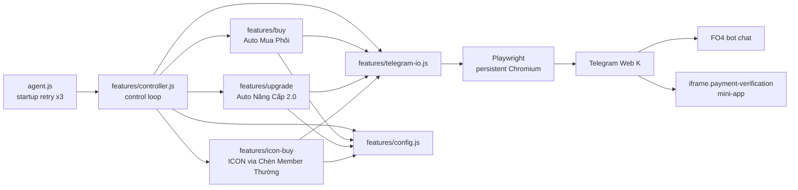
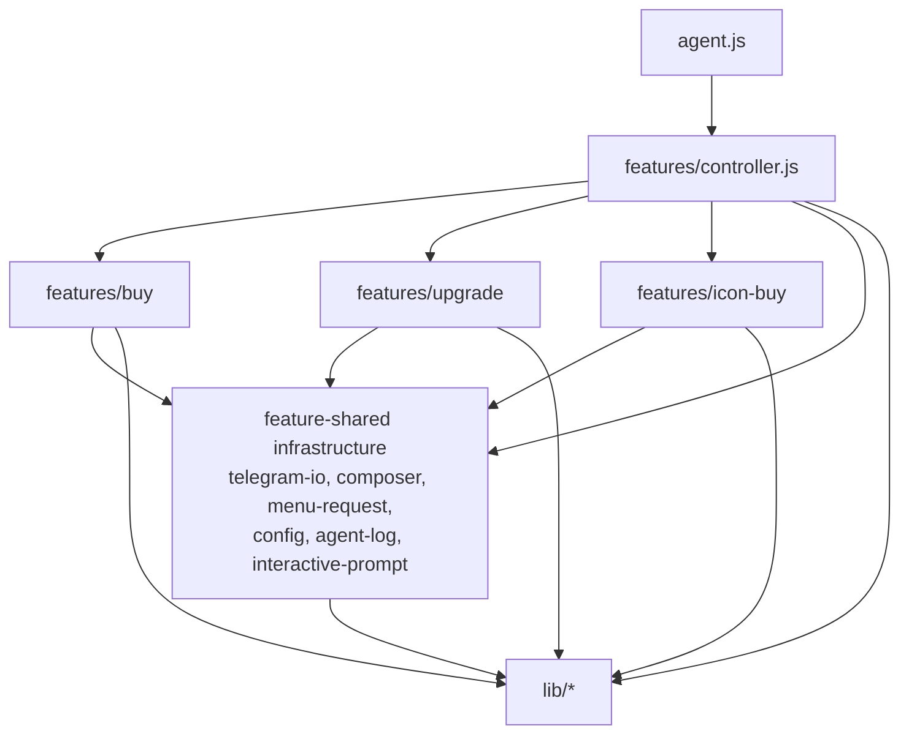
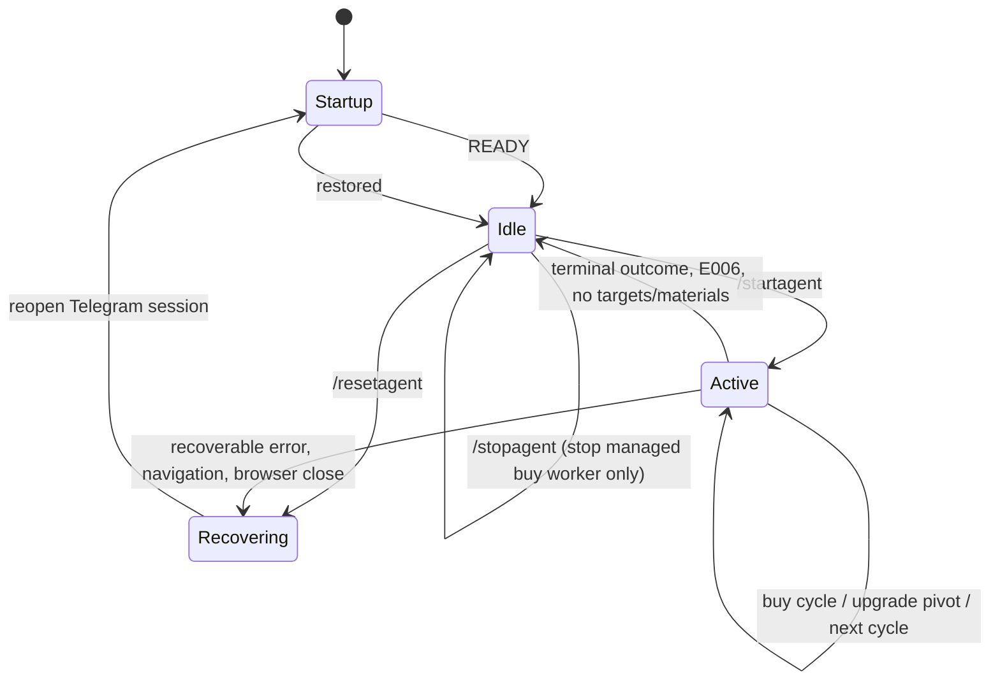

# Architecture

> Grounded in the source at commit `8c1b38b` (`v1.1`). Every statement below is traceable to a file in this repository. UI labels are quoted exactly as the code matches them.

## 1. What the system is

A local, single-process Node.js agent that drives **Telegram Web K** with Playwright and controls an FO4 bot through chat commands and the bot's embedded mini-app iframes.

- Runtime entry: `agent.js` → `features/controller.js`
- Browser: Chromium persistent context (`playwright`), profile under `%LOCALAPPDATA%\FO4PurchaseAgent\telegram-profile`
- Target chat: `https://web.telegram.org/k/#@Nguyenanh_fo4_bot` (override: `FO4_TELEGRAM_URL`)
- Mini-app surface: the last visible `iframe.payment-verification`
- No HTTP server, database, or external API client is part of the runtime path. State is held in process memory plus the persistent browser profile.

## 2. System context

The bot and the game backend are external. The agent only reads chat text and manipulates Telegram/mini-app DOM; it never calls the game backend directly.

## 3. Startup and entry point

`agent.js` contains the process entry:

- Calls `runAgent()` from `features/controller.js`.
- `MAX_STARTUP_RETRIES = 3`; on rejection it waits 10 seconds and retries.
- After the last attempt it sets `process.exitCode = 1`.
- `runAgent()` only rethrows errors that escape `main()`; recoverable runtime errors are handled inside the control loop.

`main()` startup sequence (`features/controller.js`):

1. `validateConfig()` from `features/config.js`.
2. Create a `readline` interface on stdin/stdout.
3. `launchTelegramContext()` with a 180 s timeout.
4. `openTelegramPage()` — `page.goto(BOT_URL)` and dismiss Telegram onboarding tips.
5. Log a warning if `isTelegramLoginPage(page)` matches the login screen.
6. `observeChatText(page, handleControlCommand)` installs the chat observer.
7. `ensureMessageComposer(page, rl)` finds the Telegram message input.
8. Arm the chat tracker and `waitForTextToSettle(reader, 1500, 30000, page)`.
9. Log `Agent READY` and enter the control loop.

### Browser launch fallbacks

`lib/browser-session.js` launches a persistent Chromium context with:

- `headless` from `FO4_HEADLESS=true` (default headed)
- viewport 1360×900
- 120 s launch timeout
- flags to suppress crash-restore and first-run bubbles

On a detected Chromium launch crash it tries, in order:

1. `FO4_BROWSER_PATH` or a detected Microsoft Edge executable
2. headless Chromium

`isTelegramLoginPage()` detects the QR/phone login screen by body text.

## 4. Layering and dependency rules

The codebase enforces a one-way dependency structure:

Rules expressed in code and comments:

- The controller decides **which phase runs**. Purchase and upgrade logic live inside their feature modules (`features/controller.js` header).
- `features/buy` does **not** import `features/upgrade`. On an inventory-full outcome it only returns a `pivotToUpgrade` signal; the controller calls the upgrade feature (`features/buy/outcome.js`).
- `features/upgrade` does **not** import `features/buy`. It receives `runUpgrade`/`ui` from the controller and returns actions (`features/upgrade/loop.js`).
- `features/icon-buy` does **not** import buy or upgrade; it uses shared Telegram/menu/TTCN helpers (`features/icon-buy/index.js`, `runner.js`).
- `lib/` does not import `features/`; shared command constants were moved to `lib/control-commands.js`.
- Shared helpers are imported directly by their consumers, not re-exported through feature indexes (`features/buy/index.js` header).

## 5. Module map

| Path | Responsibility |
|---|---|
| `agent.js` | Process entry, bounded startup retry |
| `features/controller.js` | Control loop, command handling, phase selection, recovery, buying/upgrade wiring |
| `features/config.js` | Merges `config.json` with defaults, exposes `getUpgradeSpec()`, runs validators |
| `features/agent-log.js` | Timestamped console + file logging |
| `features/interactive-prompt.js` | Wakeable stdin prompt for login/recovery, wakeable by `/resetagent` |
| `features/telegram-io.js` | Browser/page open, bot chat detection, command send, `/tn` cooldown, frame inspection, mini-app close |
| `features/composer.js` | Locate, wait for, reload, and refill the Telegram message input |
| `features/menu-request.js` | `/tn` menu request loop with rate-limit handling |
| `features/buy/index.js` | Public API for Auto Mua Phôi |
| `features/buy/patterns.js` | Pure parsers for buy chat signals and cycle baselines |
| `features/buy/menu.js` | Find Auto Mua Phôi button, wait for a fresh menu |
| `features/buy/mini-app.js` | Open trade mini-app, configure OVR/price/quantity, `getTradeFrame` |
| `features/buy/cycle.js` | `/stop` status check, start ACK, cycle completion wait, `/stopauto`, inventory receipt |
| `features/buy/outcome.js` | Post-cycle decision, pivot signal, completion record |
| `features/upgrade/index.js` | Public API for Auto Nâng Cấp 2.0 |
| `features/upgrade/patterns.js` | Pure parsers for upgrade terminals, target cards, OVR, menus |
| `features/upgrade/mini-app.js` | Open/config upgrade mini-app, target selection, phôi filtering, start |
| `features/upgrade/runner.js` | One upgrade run, start ACK, completion wait, `/stopnc`, inventory count |
| `features/upgrade/loop.js` | Outcome settling, single upgrade, master upgrade phase loop |
| `features/icon-buy/index.js` | Public API for ICON buying |
| `features/icon-buy/runner.js` | Background ICON task loop, slot accounting, late bad-position cancellation |
| `features/icon-buy/order.js` | Open "Chèn Member Thường → Mua cầu thủ", place orders, wait results |
| `features/icon-buy/tasks.js` | Read `/stop` menu, count `MUA` slots, `E003` baseline |
| `features/icon-buy/ttcn.js` | Cancel bad-position orders through `Gỡ cầu thủ TTCN` |
| `features/icon-buy/menu.js` | ICON feature button/menu helpers, multi-line sends |
| `features/icon-buy/favorites.js` | Read favorite ICON players |
| `features/icon-buy/patterns.js` | ICON order/position/TTCN parsers |
| `features/icon-buy/chat-messages.js` | Message-id based new-message reading |
| `lib/browser-session.js` | Persistent Chromium launch, fallbacks, login detection |
| `lib/playwright-utils.js` | `withTimeout`, closed-session/navigation/timeout classifiers |
| `lib/chat-observer.js` | MutationObserver tracker, publish/reset, wait-for-change |
| `lib/chat-runtime.js` | Shared observer instance, `verifyTailOrphan`, fresh-text helpers |
| `lib/chat-state.js` | `WeakMap<Page, tracker>` |
| `lib/text-utils.js` | Fresh-text extraction, command matching, near-miss detection |
| `lib/bot-patterns.js` | Bot regexes and timing constants |
| `lib/bot-signals.js` | E006 and rate-limit detection |
| `lib/control-commands.js` | `/startagent`, `/stopagent`, `/resetagent`; mode map |
| `lib/ui-lock.js` | Async mutex for Telegram UI actions |
| `lib/chat-scroll.js` | Scroll chat to bottom |
| `scripts/check-secrets.js` | Secret scanner used by npm scripts |

`features/control-commands.js` is a backward-compatible re-export of `lib/control-commands.js`.

## 6. Control loop

The controller is a single `while (true)` loop with explicit state held in local variables:

- `agentActive` — idle vs active
- `mode` — `null`, `"master"` (buy + upgrade pivot), or `"nang"` (upgrade-only branch)
- `sessionUnavailable` — Telegram page must be reopened
- `remoteResetRequested` — `/resetagent` received
- `ui` — shared UI mutex
- `iconMonitor` — background ICON promise

### Idle state

`waitForControlCommand(page)` drains the tracker command queue and otherwise waits on chat changes, logging every `CONTROL_COMMAND_STATUS_LOG_INTERVAL_MS` (15 s) and suggesting near-miss command spellings.

- `/startagent`: `mode = "master"`, resets cycle counters/baselines, records the current inventory-receipt count, and activates.
- `/stopagent`: sends `/stop` to inspect the auto-buy worker. If auto-buy is running, it sends `/stopauto`. It does **not** discover or stop upgrade/other workers (`features/controller.js`, `features/buy/cycle.js`).
- `/resetagent`: stops the ICON monitor, clears state, closes the browser context (20 s race), and marks the session unavailable.

### Active state — master

Order of checks in one iteration:

1. If `sessionUnavailable`, call `restoreTelegramSession()`: reopen page, re-observe chat, ensure composer, arm tracker, wait for settle.
2. If `mode === "nang"`, run the upgrade-only branch.
3. If a menu backoff is active, sleep up to 5 s and continue.
4. Adopt/synchronize with an already-running buy worker:
   - Check `/stop` if a prior check is done or chat says auto-buy is running.
   - If running, wait for that cycle and settle its outcome; no new cycle is started.
5. Verify a suspected orphan worker:
   - If chat says running, scroll to tail and re-read (`verifyTailOrphan`).
   - If still running, gather 5 minutes of evidence (`confirmSuspectedWorker`); adopt or clear.
6. Ensure the background ICON monitor is running (`runIconBuy`).
7. If inventory availability is unknown, open the upgrade mini-app once and inspect ICON cards (`inspectInventoryIcons`).
   - A new "Đã nhận … cầu thủ trong kho mua" receipt forces an immediate re-check.
   - At least one ICON below `upgrade.targetGrade` (`eligible > 0`): mark inventory usable and continue.
   - No ICON, or every ICON already at target / locked: wait `inventoryCheckIntervalSeconds` (default 1800 s); do not start a buy cycle.
8. Acquire the UI lock and start a buy cycle:
   - `getTradeFrame()` → `configureCycle()` → verify "Bắt đầu Auto Mua" is enabled
   - capture start-ACK and cycle baselines
   - click "Bắt đầu Auto Mua"
9. Wait for start acknowledgement, close the mini-app, wait for the cycle outcome.
10. Guard against a stale completion: if `completed` arrives < 60 s after start, re-check `/stop`. If a worker is still running, discard the stale notice and wait again.
11. Store the completion record, then `settleBuyOutcome()`.
12. If it returns `pivotToUpgrade`, run `pivotMasterToUpgrade()`; otherwise continue or go idle.

### Active state — `nang`

This branch checks that auto-buy is not running, then calls `runSingleUpgrade(page, rl, blockedTargetIds, ui)` repeatedly:

- `continue` / `blocked-target` → loop again
- `no-targets` → log and go idle
- `no-materials` → log and go idle
- `no-progress` → log and go idle

The only start command currently defined is `/startagent`, which maps to `mode: "master"` (`lib/control-commands.js`). The `"nang"` branch exists in the controller but no current control command selects it.

### Leaving active state

In the loop's `finally`:

- If `agentActive` became false, `mode` resets to `null` and `pendingBuyCompletion` is cleared.
- If the iteration transitioned from active to idle, one stale queued start command is consumed and discarded so it cannot start a new run unintentionally.

## 7. Concurrency and shared resources

- **One controller loop** performs all buy/upgrade phase decisions.
- **One background ICON promise** (`iconMonitor`) may run concurrently with buy/upgrade. It is started by `ensureIconMonitor()` and restarted on the next buy cycle if it ends without a stop request.
- **One UI mutex** (`lib/ui-lock.js`) serializes Telegram UI operations: menu clicks, mini-app work, `/tn`, `/stop`, `/stopauto`, `/stopnc`, composer writes.
  - Read-only waits (`waitForChatChange`, completion polling) release the lock.
  - `withLock` hands ownership directly to the next waiter on release.
- **One chat tracker per page** in a `WeakMap` (`lib/chat-state.js`). The tracker keeps text, a version counter, a pending command queue, and waiters.
- **One Telegram page/context** is owned by the controller; `openTelegramPage`/`restoreTelegramSession` replace it after recovery.
- `/resetagent` may close the context while an operation is in flight. The controller treats the resulting closed-session error as a deliberate reset, not a failure.

## 8. Chat observation model

`lib/chat-observer.js` installs a `MutationObserver` on `document.documentElement` and exposes a Playwright binding. On change it publishes `document.body.innerText` after a 75 ms debounce.

- Fresh content is extracted by `getFreshSince(baselineText, currentText)`:
  - direct suffix match
  - substring match
  - suffix anchors of 4000/1000/256 characters when Telegram trims the head
  - `null` when the snapshot was replaced entirely
- Commands are scanned only in freshly appended text; when the snapshot is replaced, a tail-window comparison (`getNewTailCommands`) is used.
- After a reload, `reattach()` reinstalls the observer on the existing tracker and calls `reset()`, which skips one command scan so old `/stopagent` text is not replayed.
- A polling fallback (`waitForChange`) scrolls the chat to bottom and re-reads the DOM with exponential backoff up to 5 s. This is the watchdog when MutationObserver misses a Telegram re-render.
- `verifyTailOrphan` presses `End`, waits 2.5 s, and re-reads the body before accepting an "orphan" terminal. This prevents an old completion visible after the user scrolled up from being mistaken for the current cycle.

## 9. Error and recovery model

### Error codes and controller handling

| Code | Produced by | Controller behavior |
|---|---|---|
| `MENU_BUSY` | Buy/upgrade menu request | Backoff `menuBusyRetrySeconds`, doubling up to 300 s; keeps agent active; does not stop workers |
| `START_ACK_TIMEOUT` | Buy start ACK when `/stop` confirms no worker | Close mini-app, wait 2 s, retry start up to 2 times |
| `START_ACK_UNVERIFIED` | Buy start ACK when `/stop` cannot be read | Reopen Telegram session, retry up to 2 times |
| `MINI_APP_BLANK` | Buy/upgrade mini-app blank > 15 s | Reopen Telegram session, up to 2 attempts |
| `MINI_APP_UI_NOT_READY` | Buy/upgrade frame visible but no usable UI | Reopen Telegram session, up to 2 attempts |
| `MINI_APP_NOT_OPENED` | Buy iframe not opened within 20 s | Reopen Telegram session, up to 2 attempts; `getTradeFrame` retries with fresh `/tn` |
| `MINI_APP_LOAD_TIMEOUT` | Upgrade iframe not loaded in time | Reopen Telegram session, up to 2 attempts; `getUpgradeFrame` retries with fresh `/tn` |
| `UPGRADE_MODE_LOAD_TIMEOUT` | Upgrade manual mode not selectable | Reopen Telegram session, up to 2 attempts |
| `MINI_APP_SERVER_DOWN` | Bot mini-app shows `ERR_NGROK_*` / upstream connection refused | Bot-side outage: keep agent active and ICON monitor running; back off 60 s → 300 s and retry |
| `BOT_SYSTEM_ERROR` | E006 anywhere | Set inactive and wait for `/startagent` |
| `TELEGRAM_NAVIGATED` / navigation regex | Telegram reload/render context loss | Reopen chat/observer, keep worker running |
| `TELEGRAM_CHAT_UNREADABLE` | ICON runner after 8 failed `/stop` reads | Reopen Telegram session |
| `INVENTORY_READ_UNCONFIRMED` | Upgrade inventory read | Treated as transient; keep master loop alive and retry next interval |
| `NO_UPGRADE_TARGETS` | Upgrade runner | Converted to `no-targets` action |
| `NO_UPGRADE_MATERIALS` | Upgrade filter/start | Converted to `no-materials` action |
| `TELEGRAM_LOGIN_REQUIRED` | Mini-app check | Propagates to recovery prompt |

`MINI_APP_BP_LOAD_TIMEOUT` is produced by the buy frame wait after the bot response deadline; it is retried inside `getTradeFrame` up to `MINI_APP_BP_LOAD_RETRIES = 2`, then falls through to the generic recovery path.

`MINI_APP_SERVER_DOWN` is produced when the iframe renders the bot's own infrastructure error page (`ERR_NGROK_8012`, "failed to establish a connection to the upstream web service", connection refused to `localhost:3000`). That is a bot-side outage, not an agent bug: both mini-app readers detect it immediately, the controller keeps `agentActive` and the ICON monitor untouched, and retries with a 60 s → 120 s → 240 s → 300 s backoff. The backoff resets after a successful inventory read, buy-frame open, or upgrade pivot.

### Generic recovery

If an error is not classified:

1. Stop the ICON monitor.
2. Set the waiting-for-recovery flag.
3. Prompt at the terminal: "Nhấn Enter hoặc gửi /resetagent để agent khôi phục và thử lại..."
4. `/resetagent` can wake the prompt through `interactive-prompt.js`.
5. The agent becomes inactive after recovery.

Browser-closed errors and Playwright timeouts are handled earlier by marking the session unavailable and reopening it; a timeout also attempts to close the stuck context with a 15 s race.

## 10. Configuration

`features/config.js` merges `config.json` with hard-coded defaults:

- Top-level buy keys come straight from `config.json`.
- Missing menu/frame values default to `45`, `15`, `30` seconds.
- `config.upgrade` defaults are overlaid with `rawConfig.upgrade`.
- `config.iconBuy` defaults are overlaid with `rawConfig.iconBuy`.

Validation (`validateConfig`) enforces:

- Positive integers for buy OVR/price/quantity/cycle/wait/menu values.
- `ovrMin <= ovrMax`.
- `quantityPerAttempt <= 5`.
- Upgrade: non-negative integer spec fields; `targetGrade >= 1`; `minRatio <= 100`; `maxUpgradeWaitMinutes >= 1`; positive target-check delays; non-empty `ovrPhoi` and `maxPriceEach`.
- ICON: `maxPlayersPerBatch <= 3`; `grade === 1` and `quantity === 1`; `maxTaskSlots <= 3`; boolean flags; non-negative timeouts.

### Effective values in the committed `config.json`

| Key | Value |
|---|---|
| `ovrMin` / `ovrMax` | 118 / 123 |
| `maxPriceBP` | 777777 |
| `quantityPerAttempt` | 3 |
| `maxPerCycle` | 14 |
| `maxCycleWaitMinutes` | 240 |
| `botResponseTimeoutMinutes` | 5 |
| `menuResponseTimeoutSeconds` | 45 |
| `menuBusyRetrySeconds` | 15 |
| `upgradeFrameTimeoutSeconds` | 30 |
| `upgrade.targetGrade` | 7 |
| `upgrade.ovrPhoi` | `"118"` |
| `upgrade.maxPriceEach` | `"2M"` |
| `upgrade.waitMs` | 5000 |
| `upgrade.minRatio` | 74 |
| `upgrade.bpProtectFromGrade` | 8 |
| `upgrade.maxUpgradeWaitMinutes` | 180 |
| `upgrade.targetCheckDelaySeconds` | 60 |
| `upgrade.targetCheckIntervalSeconds` | 120 |
| `iconBuy.maxPlayersPerBatch` | 3 |
| `iconBuy.cancelPositionAbove` | 3 |
| `iconBuy.purchaseTimeoutSeconds` | 0 (unlimited) |
| `iconBuy.purchaseSoftTimeoutSeconds` | 1800 |
| `iconBuy.monitorWaitSeconds` | 900 |
| `iconBuy.inventoryCheckIntervalSeconds` | 1800 |
| `iconBuy.maxTaskSlots` | 3 |
| `iconBuy.slotPollSeconds` | 15 |

## 11. Runtime artifacts and environment variables

| Artifact / variable | Location / effect |
|---|---|
| Telegram profile | `%LOCALAPPDATA%\FO4PurchaseAgent\telegram-profile` |
| Operational log | `%LOCALAPPDATA%\FO4PurchaseAgent\agent.log` |
| Test-mode log | `%LOCALAPPDATA%\FO4PurchaseAgent\agent.test.log` when `NODE_TEST_CONTEXT` is set |
| Debug screenshots | `./debug/auto-mua-<ISO timestamp>.png` on buy mini-app/login errors |
| `FO4_TELEGRAM_URL` | Overrides the bot chat URL |
| `FO4_BROWSER_PATH` | Overrides the fallback browser executable |
| `FO4_HEADLESS=true` | Starts Chromium headless |
| `LOCALAPPDATA` | Base directory for profile/log |

## 12. Tests and checks

`package.json` defines:

- `npm test` → `node --test`
- `npm run check` → `node --check agent.js && node --test`
- `npm run scan:secrets` → `node scripts/check-secrets.js`
- `npm run scan:history` → history scan
- `npm run scan:staged` → staged scan

Local test files:

- `agent.test.js`
- `features/autonangcap.test.js`
- `features/icon-buy/patterns.test.js`
- `features/icon-buy/tasks.test.js`
- `lib/ui-lock.test.js`

## 13. Enforced boundaries

- Buy and upgrade coordinate only through the controller; neither feature imports the other.
- All Telegram UI mutations go through the shared UI lock.
- All bot commands are sent through `sendBotCommand`/`sendTnCommand`; `/tn` has a process-wide cooldown (`TN_COMMAND_COOLDOWN_MS = 15 s`) plus the generic 4 s command delay.
- Chat state is derived from the DOM; there is no persisted purchase journal in the runtime path.
- Mini-app access is always through `iframe.payment-verification`; iframes are closed from newest to oldest to avoid stale frames interfering with later actions.
