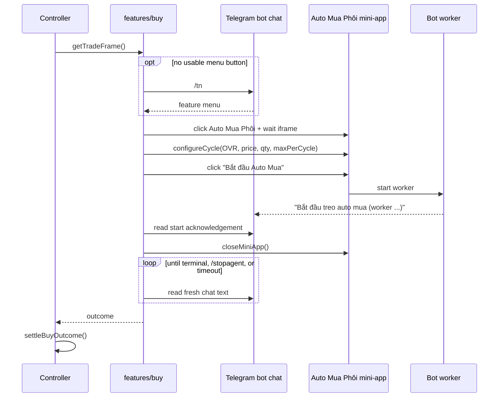
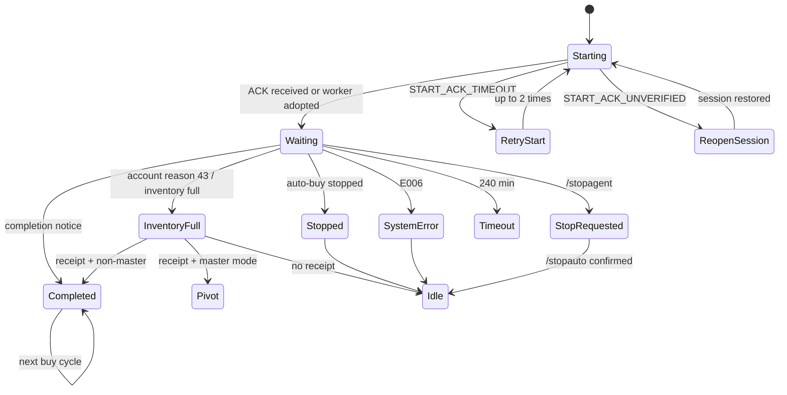

# Buy Workflow — Auto Mua Phôi

> Grounded in `features/buy/*`, `features/controller.js`, `lib/bot-patterns.js`, and `lib/text-utils.js` at commit `8c1b38b`. UI strings are exact matches from the code.

## 1. Role in the agent

Auto Mua Phôi is one phase of the controller's `master` mode. The controller owns the decision to run a buy cycle; `features/buy` contains all purchase logic and knows nothing about upgrades.

A buy cycle:

1. Opens/fills the Auto Mua Phôi mini-app.
2. Starts the bot's auto-buy worker.
3. Waits for the bot to report a terminal state.
4. Returns an outcome to the controller.
5. The controller either starts another buy cycle or pivots to upgrades.

The background ICON runner may run at the same time; all Telegram UI actions are serialized by `lib/ui-lock.js`.

## 2. Prerequisites inside the controller

Before a buy cycle is opened, the controller (`features/controller.js`) does the following:

- Ensures the ICON monitor is running (`ensureIconMonitor()`).
- If inventory availability is unknown, opens the **upgrade** mini-app once through `checkInventoryIcons(page, rl)`, which returns an inventory summary instead of a raw count:
  - At least one ICON below `upgrade.targetGrade` and not locked (`eligible > 0`) → inventory is usable; proceed with buy phôi.
  - No ICON at all (`total === 0`) → wait `iconBuy.inventoryCheckIntervalSeconds` (default 1800 s) before checking again.
  - ICONs exist but all have reached the target grade (or are locked) → **do not buy phôi**; keep the agent alive and wait for a new ICON, then check again.
  - A new "Đã nhận … cầu thủ trong kho mua" chat receipt forces an immediate re-check.
  - `INVENTORY_READ_UNCONFIRMED` is transient: log and retry next interval; do not kill the agent.
- Only then does it request the Auto Mua Phôi menu and start a cycle.

This gate prevents the mini-app from being opened every few seconds when the inventory is empty, and prevents a buy/upgrade loop when the only ICON is already `+targetGrade` (the bot would report inventory full, no new receipt would arrive, and the agent would stop after 5 minutes).

## 3. End-to-end sequence



## 4. Step 1 — acquire the feature menu

Code: `features/buy/menu.js`, `features/buy/mini-app.js`, `features/menu-request.js`, `features/telegram-io.js`.

### Reuse an existing button

`findCurrentButton(page)`:

1. Scrolls the chat to the bottom.
2. Tries a visible button named exactly `Auto Mua Phôi`.
3. Falls back to `.reply-markup-button` filtered by text `Auto Mua Phôi`.
4. Returns the last match.

`clickBuyMenu` uses this button first. It only requests `/tn` when:

- no button is found,
- `forceTn` is true, or
- clicking a stale button throws and the menu was not freshly fetched.

If a click on a stale button fails, the module sends `/tn` once and retries the click.

### Fetch a fresh menu with `/tn`

`requestBuyMenu()` calls `requestMenuWithTn()`:

- Label: `Auto Mua Phôi`
- Baseline: E006 count, rate-limit count, full chat text
- Timeout: `menuResponseTimeoutSeconds` (45 s)
- Up to 3 `/tn` attempts
- Each send goes through `sendTnCommand()`:
  - process-wide `TN_COMMAND_COOLDOWN_MS = 15 s`
  - generic `BOT_COMMAND_DELAY_MS = 4 s`
- If the bot says "thao tác quá nhanh … chờ N s", it waits the requested delay and retries within the deadline.

`waitForMenuReply()` accepts a menu when:

- The freshly appended text contains the feature-menu signature (`hasFreshFeatureMenu`), or
- The snapshot was replaced but still contains a valid menu signature.

A menu is valid when it contains `Auto Mua Phôi` **and** at least one other known feature label (`lib/bot-patterns.js`, `FEATURE_MENU_LABELS`), so a single notification cannot be mistaken for a menu.

Result mapping:

| Result | Error |
|---|---|
| `system-error` | `BOT_SYSTEM_ERROR` |
| `timeout` or `rate-limited` | `MENU_BUSY` (controller backs off) |
| No button after a valid menu | Plain error → generic recovery |

If the chat history still contains an Auto Mua Phôi menu but no clickable button, the code logs that and fetches a new menu rather than clicking a dead keyboard.

## 5. Step 2 — open and validate the mini-app

Code: `features/buy/mini-app.js`.

`openTradeFrame()`:

1. If an existing mini-app already shows `Bắt đầu Auto Mua`, reuse it (unless `forceTn`).
2. Otherwise close any open mini-app (`closeMiniApp`, newest iframe first).
3. Click the menu button.
4. Wait for the trade frame.

`waitForTradeFrame()` accepts the frame only when:

- Telegram is not on the login page (`TELEGRAM_LOGIN_REQUIRED` otherwise), and
- `isTradeFrameLoaded(body)` is true:
  - body does **not** contain `Đang tải`, and
  - body matches `Giá hiển thị\s*:\s*[\d.,]+\s*BP`.

### Frame timeout ladder

| Condition | Deadline | Error |
|---|---|---|
| No `iframe.payment-verification` | 20 s from open | `MINI_APP_NOT_OPENED` |
| Frame visible but body empty | 15 s after first frame | `MINI_APP_BLANK` |
| Frame open but no `Bắt đầu Auto Mua` or no BP | 45 s from open | `MINI_APP_UI_NOT_READY` |
| Still loading / no BP | `botResponseTimeoutMinutes` (5 min) | `MINI_APP_BP_LOAD_TIMEOUT` |

`getTradeFrame()` retries retryable codes up to `MINI_APP_BP_LOAD_RETRIES = 2`:

- `MINI_APP_BP_LOAD_TIMEOUT`
- `MINI_APP_UI_NOT_READY`
- `MINI_APP_NOT_OPENED`
- `MINI_APP_BLANK`

Only `MINI_APP_NOT_OPENED` forces a fresh `/tn`; blank/not-ready frames are closed and the existing menu is retried without asking the bot again.

On `TELEGRAM_LOGIN_REQUIRED` or any `MINI_APP_*` error, a screenshot is saved to `./debug/auto-mua-<timestamp>.png`.

## 6. Step 3 — configure the cycle

Code: `features/buy/mini-app.js#configureCycle`.

The mini-app must expose:

- at least 4 `spinbutton` inputs (`OVR tối thiểu`, `OVR tối đa`, `số lượng mỗi lần`, `số lượng mỗi chu kỳ`)
- exactly 1 `textbox` for the BP price

The controller passes `units = config.maxPerCycle` as the cycle quantity. Values written:

| Field | Value |
|---|---|
| OVR min | `config.ovrMin` (118) |
| OVR max | `config.ovrMax` (123) |
| Quantity per attempt | `config.quantityPerAttempt` (3) |
| Quantity per cycle | `config.maxPerCycle` (14) |
| Max price (BP) | `config.maxPriceBP` (777777) |

`setCycleField()` retries up to 4 times:

1. Click the field.
2. `Control+A`, `Backspace`.
3. `fill(expected)`.
4. `Tab`.
5. Read `inputValue()` and require an exact string match.

After writing all fields, `configureCycle()` reads them back and enforces:

```
actual.ovrMin             === config.ovrMin
actual.ovrMax             === config.ovrMax
actual.maxPriceBP         === config.maxPriceBP
actual.quantityPerAttempt === config.quantityPerAttempt
actual.maxPerCycle        === maxPerCycle
```

If the BP price did not stick, it is rewritten once. If the per-attempt quantity did not stick, that field is rewritten once. Any remaining mismatch throws and no cycle is started. The controller wraps this in a 90 s timeout.

## 7. Step 4 — start and capture baselines

Code: `features/controller.js` (active master block), `features/buy/cycle.js`.

Before clicking:

1. Re-check for a new E006 since the menu was requested; if present, go inactive.
2. Require the `Bắt đầu Auto Mua` button to be enabled.
3. Check for `/stopagent`; if received, skip the click and go inactive.
4. Re-check E006 again.
5. Capture:
   - `started` count of `Bắt đầu treo auto mua`
   - latest started-line marker
   - system-error count
   - full chat text
   - `getCycleBaseline(text)` (completions, started, active, latest activity marker, stops, inventory-full stops, inventory receipts, etc.)
   - `cycleStartedAt`
6. Click `Bắt đầu Auto Mua` with a 60 s timeout.

## 8. Step 5 — wait for start acknowledgement

Code: `features/buy/cycle.js#waitForStartAcknowledgement`.

Wait budget:

```
min(config.botResponseTimeoutMinutes * 60_000, BUY_START_ACK_TIMEOUT_MS)
= min(5 min, 90 s) = 90 s
```

Acceptance signals:

- fresh text contains `Bắt đầu treo auto mua`, or
- `hasNewStartAcknowledgement()` sees either a higher started count or a different latest started marker.

Any new E006 → `BOT_SYSTEM_ERROR`.

### If 90 s pass without an ACK

The agent verifies reality with `/stop` (up to 2 attempts, 5 s apart):

| `/stop` result | Action |
|---|---|
| Auto-buy worker is running | Adopt it: log, use its baseline, continue waiting |
| Confirmed no worker | `START_ACK_TIMEOUT`; controller closes the mini-app and retries the start up to 2 times |
| Status unreadable | `START_ACK_UNVERIFIED`; controller reopens Telegram Web and retries up to 2 times |

This avoids starting a second worker and spending BP when the bot lagged and dropped the click.

After acceptance:

- `cycleBaseline` is rebuilt from the acknowledged chat text and its latest activity marker.
- The mini-app is closed.
- The started worker id is logged from `(worker <id>)`.
- A stale `pendingBuyCompletion` is cleared because a new cycle has started.

## 9. Step 6 — wait for the cycle outcome

Code: `features/buy/cycle.js#waitForCycleCompletion`, `features/buy/patterns.js`.

Maximum wait: `maxCycleWaitMinutes` (240 min; the bot's hold can reach ~180 min, so the cap must be above it).

### Terminal signals, in priority order

1. `/stopagent` command → `{ status: "stop-requested" }`
2. Fresh-text outcome (`getCycleOutcomeFromFresh`):
   - new worker token-refresh stop (`Worker dừng do không thể làm mới token sau N lần thử`) → `system-error`, even while ICON-attributed E006s are being ignored
   - new E006 → `system-error`
   - new inventory-full stop newer than the latest activity → `inventory-full`
   - new auto-buy stop newer than the latest activity/completion → `purchase-stopped`
   - new completion newer than the latest activity → `completed`
3. Orphan terminal (chat window no longer contains activity but a specific auto-buy terminal remains) → same statuses, after `verifyTailOrphan` confirms it
4. New E006 anywhere → `system-error`
5. New full-inventory stop → `inventory-full`
6. New stopped notice → `purchase-stopped`
7. New completion notice → `completed`

Bare "Đã dừng N luồng thành công" is deliberately **not** used as an orphan terminal because it could belong to another manual worker.

### ICON E006 attribution

The ICON flow shares the same Telegram chat as Auto Mua Phôi. When ICON sends `/tn`, clicks a feature button, or sends a purchase list, the bot can answer that request with E006. `lib/icon-activity.js` records the time of those actions; a new E006 is ignored by the buy waiter when it arrives within `ICON_E006_ATTRIBUTION_MS` (120 s) of an ICON action. The ignored error is logged, the error baseline advances, and the waiter keeps looking for real cycle signals. A completion arriving in the same window — including `Hết thời gian treo. Hoàn thành mua N cầu thủ` — is still accepted, so a finished cycle is not lost.

Without recent ICON activity, E006 keeps its old meaning: the buy cycle ends as `system-error` and the agent goes idle until `/startagent`. The explicit `Worker dừng do không thể làm mới token sau N lần thử` message is always terminal, regardless of recent ICON activity.

### Chat patterns used

| Meaning | Regex source |
|---|---|
| Started / activity | `Bắt đầu treo auto mua`, `Đang treo mua cho chatId` |
| Completed | `Đã mua đủ N cầu thủ` or `Hết thời gian treo. Hoàn thành mua N cầu thủ` |
| Auto-buy stopped | `Đã dừng treo auto mua cho chatId <id>` |
| Inventory full | `account reason = 43 … Toàn bộ kho … đầy` / `Dừng auto mua …` |
| Inventory receipt | `Đã nhận N cầu thủ trong kho mua … Tiếp tục mua` |
| `/stop` menu | `Chọn luồng cần dừng cho chatId` |
| Auto-buy option present | `Mua phôi |` |
| No running task | `Hiện không có lệnh nào đang chạy` / `Không có worker nào đang chạy cho tài khoản này` |
| E006 | `E006: Lỗi hệ thống, vui lòng thử lại sau hoặc liên hệ hỗ trợ` |
| Worker token stop | `Worker dừng do không thể làm mới token sau N lần thử` |
| Rate limit | `Bạn thao tác quá nhanh … Vui lòng chờ N s rồi thử lại` |
| Purchase event | `Mua thành công!` |

### Stale completion guard

If `completed` arrives **less than 60 s** after the start click:

1. Call `checkAutoBuyRunning()` via `/stop`.
2. If a worker is still running → treat the notice as a replayed old completion, discard it, and wait again on the worker's baseline.
3. If `/stop` cannot be read → keep waiting from the current chat baseline; do not start a new cycle.

This is the `STALE_COMPLETION_GUARD_MS = 60_000` guard.

### Chat trimming and orphan verification

`getFreshSince()` compares the current body with the saved baseline using suffix/substring/anchored matching. If Telegram replaced the whole snapshot, the parser falls back to counting terminal notices against the baseline.

When an orphan terminal is suspected, `verifyTailOrphan()` presses `End`, waits 2.5 s, and re-reads the body. If the terminal disappears, it was old history and the agent keeps waiting. Verification is throttled to once per 60 s.

## 10. Step 7 — settle the outcome

Code: `features/buy/outcome.js#settleBuyOutcome`.

| Outcome | Behavior |
|---|---|
| `stop-requested` | Send `/stopauto` via `stopPurchaseWorker`; resume only if a start command was received during the stop |
| `inventory-full` | `waitForInventoryReceipt()` up to 5 min. Receipt confirmed → in `master` return `pivotToUpgrade`; otherwise open the next buy cycle. Receipt absent → go inactive for safety |
| `system-error` | Log E006 message, go inactive, wait for `/startagent` |
| `purchase-stopped` | Log, go inactive, wait for `/startagent` |
| `completed` | Log `completedLog` and open the next cycle |
| any other | Treated as completed: log and open the next cycle |

Important ordering: `inventory-full` is handled **before** `idleOutcomeMessage`, so in `master` mode it pivots to upgrades instead of going idle.

## 11. `/stopagent` and worker stopping

### While idle

The controller sends `/stop` to inspect auto-buy:

- If a buy worker is running → `stopPurchaseWorker()` sends `/stopauto` and waits for confirmation.
- If no buy worker is running → logs that other workers are left untouched.
- A start command received during the stop is remembered and resumes the agent afterward.

### While waiting for a cycle

`waitForCycleCompletion()` returns `stop-requested` as soon as `/stopagent` is consumed; `settleBuyOutcome()` then performs `/stopauto`.

### `/stopauto` confirmation

`stopPurchaseWorker()`:

- Sends `/stopauto`.
- Waits up to `botResponseTimeoutMinutes` (5 min).
- Treats any of these as confirmed:
  - fresh stop confirmation
  - orphan terminal
  - new stopped notice
  - new completion notice
  - a new "no running task" notice
- Honors rate limits by waiting the requested delay and resending.
- Returns the last start command received during the stop, or `null`.

## 12. Outcome state diagram



## 13. Buy configuration reference

| Key | Effective | Effect |
|---|---|---|
| `ovrMin` | 118 | Mini-app minimum OVR |
| `ovrMax` | 123 | Mini-app maximum OVR |
| `maxPriceBP` | 777777 | Max price written to the BP field |
| `quantityPerAttempt` | 3 | Players per purchase attempt (validator allows ≤5) |
| `maxPerCycle` | 14 | Players per buy cycle / mini-app 4th field |
| `maxCycleWaitMinutes` | 240 | Hard cap on waiting for a cycle terminal; must exceed the bot's ~180 min hold |
| `botResponseTimeoutMinutes` | 5 | `/stop`, `/stopauto`, inventory receipt, menu/body deadlines |
| `menuResponseTimeoutSeconds` | 45 | `/tn` menu deadline |
| `menuBusyRetrySeconds` | 15 | First `MENU_BUSY` backoff; doubles to 300 s |
| `upgradeFrameTimeoutSeconds` | 30 | Shared mini-app frame timeout constant |

## 14. Safety properties proven by the code

- A new cycle is never started while a worker is confirmed running: `/stop` is checked before the menu, a suspected worker is given a 5-minute evidence window, and the start button is only clicked otherwise.
- An early completion (< 60 s) is never trusted without a `/stop` re-check.
- A terminal found in old scrolled history is verified at the chat tail before acceptance.
- If the start click is dropped, the agent retries only when `/stop` proves no worker exists; if it cannot verify, it reopens Telegram instead of clicking blindly.
- The mini-app is closed after acknowledgement so it cannot cover the Telegram composer.
- E006 always returns the agent to idle; it never loops on the bot.
- `/stop` is used only to read status. The code explicitly never clicks a `/stop` menu option or uses `/stop` to stop a worker.
