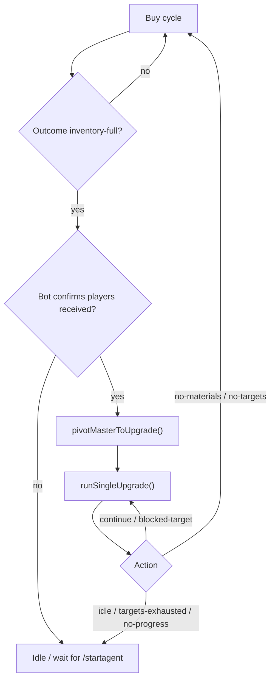
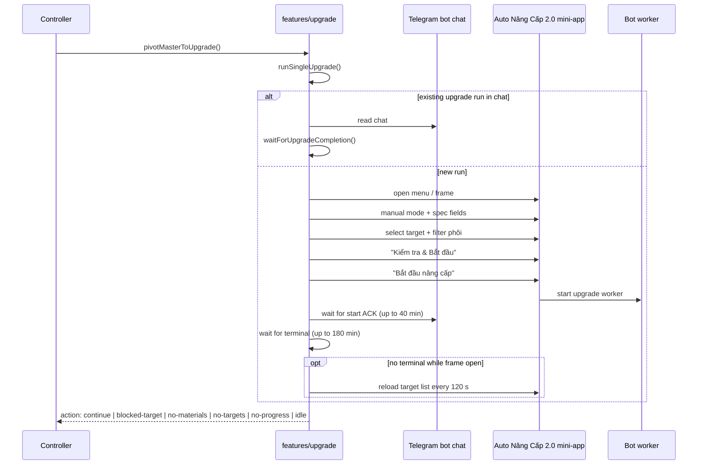

# Upgrade Workflow — Auto Nâng Cấp 2.0

> Grounded in `features/upgrade/*`, `features/controller.js`, and `features/config.js` at commit `8c1b38b`. UI strings are exact matches from the code.

## 1. Role in the agent

Auto Nâng Cấp 2.0 consumes ICON cards from the inventory and upgrades a target to `upgrade.targetGrade`. It runs in two situations:

1. **Master pivot**: after a buy cycle reports `inventory-full` and the bot confirms players were received into the inventory, the controller switches from buying to repeated upgrade runs (`pivotMasterToUpgrade`).
2. **Upgrade-only branch**: when the controller's `mode` is `"nang"`, it repeatedly calls `runSingleUpgrade` without touching buying (`features/controller.js`).

The only control command currently defined is `/startagent`, which maps to `master` (`lib/control-commands.js`). The `"nang"` branch exists but no current control command selects it.

## 2. Trigger and phase ownership



The controller calls the pivot only when `mode === "master"` (`handleBuyOutcome`). The buy feature never calls upgrade code; it only returns the `pivotToUpgrade` signal.

## 3. End-to-end sequence



## 4. Adopt an existing upgrade run

Code: `features/upgrade/loop.js#runSingleUpgrade`, `features/upgrade/patterns.js#getExistingUpgradeRun`.

Before opening a new mini-app, `runSingleUpgrade` calls `getExistingUpgradeRun(chatText)`:

- Chat history is split into runs at each `Đã khởi động Auto Nâng Cấp` line.
- If the last run has **no terminal**, it returns `{ status: "running", baseline }`.
- The agent waits for that run with `waitForUpgradeCompletion`, settles its outcome, closes the mini-app, and returns.
- This avoids starting a second worker while one is already running.

If there is no existing run, it calls `runUpgradeOnce`.

## 5. Open the upgrade menu and frame

Code: `features/upgrade/mini-app.js`, `features/menu-request.js`.

### Menu button discovery

`findNcMenuButton(page)`:

- Scans every `.reply-markup-button` and keeps the **last** visible button whose text matches `/nâng cấp 2\.0/i`.
- Fallback: visible text matching `Auto Nâng Cấp 2.0` that is actually inside a clickable element (`button`, `[role=button]`, or `.reply-markup-button`).
- The fallback prevents a plain chat message containing the feature name from being clicked.

### Fetch with `/tn`

`requestUpgradeMenu()` → `requestMenuWithTn()`:

- Label: `Auto Nâng Cấp 2.0`
- Timeout: `menuResponseTimeoutSeconds` (45 s)
- Up to 3 `/tn` sends with the 15 s `/tn` cooldown
- Rate-limit delays are honored

`waitForNcMenuButton()` accepts the menu when:

- fresh text contains a valid upgrade menu (`hasFreshUpgradeMenu`), or
- the snapshot was replaced but the menu-button count increased and the current snapshot contains a recent upgrade menu.

Result mapping:

- `timeout` / `rate-limited` → `MENU_BUSY`
- `system-error` → `BOT_SYSTEM_ERROR`
- no button → plain error

### Frame readiness

`openUpgradeFrame()` first dismisses a "Chúc bạn may mắn" popup. It then reuses an existing frame if a visible `Kiểm tra & Bắt đầu` button is present. Otherwise it closes all mini-apps and clicks the menu.

`waitForUpgradeFrameReady()` returns the frame when:

- the body contains a target card (`_id: <hex>`), or
- the configuration form is rendered:
  - `Kiểm tra & Bắt đầu` **and**
  - (`Lọc phôi từ kho` **or** `Bước 3: Nhập giá tối đa mỗi phôi`)
  - and that form has remained visible for `UG_EMPTY_LIST_GRACE_MS = 15 s` so an empty target list is not mistaken for a slow render.

Errors:

| Condition | Error |
|---|---|
| Frame body empty > 15 s | `MINI_APP_BLANK` |
| Login screen detected | `TELEGRAM_LOGIN_REQUIRED` |
| No frame loaded in `upgradeFrameTimeoutSeconds` (30 s) | `MINI_APP_LOAD_TIMEOUT` |
| Frame exists but UI not ready | `MINI_APP_UI_NOT_READY` |

`getUpgradeFrame()` retries once (`MINI_APP_LOAD_RETRIES = 1`) for `MINI_APP_LOAD_TIMEOUT`, `MINI_APP_UI_NOT_READY`, and `MINI_APP_BLANK`. Only `MINI_APP_LOAD_TIMEOUT` forces a fresh `/tn`.

## 6. Configure the upgrade run

Code: `features/upgrade/mini-app.js#configureUpgradeFrame`, `features/upgrade/patterns.js`.

### Manual mode

The mini-app must be in manual mode. The code:

1. Checks for a `mode: manual` line (`isManualUpgradeModeText`).
2. Clicks `#modeManual` if present.
3. Falls back to a button matching `1 Tự chọn phôi` (accepts `1`, `1.`, `1)` variants).
4. Repeats up to 4 attempts.
5. Throws `UPGRADE_MODE_LOAD_TIMEOUT` if manual mode cannot be selected.

### Advanced sections

`expandUpgradeAdvanced()` opens the `<details>` sections whose summaries contain `kiểu chạy`, `tỉ lệ`, or `về phôi` by setting `details.open = true`. This is idempotent; clicking an already-open summary would close it and hide the mode selector. A fallback clicks labels only when their expanded state is known to be closed.

### Spec fields

The code fills by visible input label and reads the value back after each attempt (up to 4 attempts):

| Input label | Value |
|---|---|
| `Thời gian chờ giữa mỗi lần nâng` | `upgrade.waitMs` (5000) |
| `Tỉ lệ tối thiểu` | `upgrade.minRatio` (74) |
| `OVR phôi` | `upgrade.ovrPhoi` (`"118"`) |
| every visible `Giá tối đa` | `upgrade.maxPriceEach` (`"2M"`) |

The target grade is selected from the combobox whose text matches `+2 … +13`:

```js
selectOption({ label: `+${spec.targetGrade}` })
```

If no such combobox exists, it throws.

### BP Protection

`shouldProtectBp(targetGrade, bpProtectFromGrade)` returns `targetGrade >= bpProtectFromGrade`.

With the committed config (`targetGrade = 7`, `bpProtectFromGrade = 8`), BP Protection is set to **OFF**. The checkbox is `BP Protection`, and the code verifies the resulting checked state (normal check, forced check, then JS set + events).

## 7. Read and choose a target

Code: `features/upgrade/mini-app.js#readUpgradeTargetCards`, `features/upgrade/patterns.js#parseUpgradeTargetCards`.

`readUpgradeTargetCards()` reads **only** `#targetsList` (falling back to `body`), collecting buttons that contain `_id:`. It deliberately avoids the whole document so reserve cards in `#materialsList` are not counted twice.

A card is a valid target only when:

1. It has `_id:<hex>` and `+<grade>`.
2. It has an ICON badge image. Badge detection accepts:
   - filenames matching `icon*.png`, `mcicon*.png`, `tki*.png`, or
   - Garena `season-icon/<id>.png` with season id in `100, 101, 110, 111, 202, 213`.
3. It is not locked: no `KHÓA` text and `disabled` is false.
4. `grade < targetGrade`.

Price is parsed from `Giá <amount>` and supports `K`/`M`/`B` suffixes (`parseMarketPrice`).

Candidates are sorted by grade ascending, then price ascending. Selection:

- If `targetId` is provided, the matching candidate is required; otherwise `NO_UPGRADE_TARGETS`.
- Otherwise the first candidate is chosen.

If no candidates remain, the runner logs a summary:

```
total, notIcon, locked, reachedTarget, invalid, duplicate, eligible
```

and throws `NO_UPGRADE_TARGETS`. It also distinguishes "all valid icons are blacklisted in this phase" from "no valid icons at all".

`selectUpgradeTarget()` finds a button whose text matches `_id:<target.id>` and throws if the card says `KHÓA` or is disabled.

## 8. Filter phôi

Code: `features/upgrade/mini-app.js#filterUpgradePhoi`, `ensureUpgradeFilterInputs`.

1. Ensure the visible `OVR phôi` input equals `upgrade.ovrPhoi`; rewrite it if not.
2. Ensure every visible `Giá tối đa` input equals `upgrade.maxPriceEach`.
3. Click `Lọc phôi từ kho`.
4. Wait for the loader to hide.
5. Read the selected count from:
   - `Đã chọn: N phôi`, or
   - buttons whose text/class contains `ĐÃ CHỌN` or `selected`.
6. If no phôi is selected, retry the filter once.
7. Still zero → `NO_UPGRADE_MATERIALS`.

After filtering, the code reads the OVR printed on each selected card (`OVR <n>`) and requires every selected OVR to be in the allowed set parsed from `upgrade.ovrPhoi` (comma list or inclusive range). Any offender aborts the run before starting.

## 9. Final check and start

Code: `features/upgrade/mini-app.js#checkUpgradeAndStart`, `pressUpgradeStart`.

1. Click the button whose text is exactly `Kiểm tra & Bắt đầu`.
2. Wait 4 s and read the body.
3. **No final confirmation UI comparison is performed.** The code logs:
   - "Đã gửi kiểm tra nâng cấp với N phôi đã lọc; bỏ qua đối chiếu lại UI cuối vì mini-app có thể khóa/đánh dấu lại các thẻ."
   - A parser `verifyUpgradeFinalUi()` exists in `features/upgrade/patterns.js` but is only referenced by tests; `runUpgradeOnce` does not call it.
4. Capture the ACK baseline: cycle baseline + progress count + full chat text.
5. Click the visible, enabled button whose text is exactly `Bắt đầu nâng cấp`.
6. If no such button exists → `NO_UPGRADE_MATERIALS`.
7. Dismiss the "Chúc bạn may mắn" popup by clicking a visible `CLOSE` button, best effort.

The UI lock is released while waiting for the bot, then reacquired in a `finally`.

## 10. Wait for start acknowledgement

Code: `features/upgrade/runner.js#waitForUpgradeStartAck`.

- Hard limit: `UG_START_ACK_MS = 40 minutes`.
- Heartbeat log every 60 s.
- Success if any of these appears:
  - fresh `Đã khởi động Auto Nâng Cấp`
  - fresh upgrade progress
  - fresh terminal
  - a new terminal key or higher terminal count
  - a new start notice
- New E006 → `BOT_SYSTEM_ERROR`.
- Timeout → plain error; the agent does not resend the start automatically.

Immediately after ACK, the runner checks for a terminal that arrived together with the ACK. If a summary is already available, it records `completed` directly.

## 11. Wait for completion

Code: `features/upgrade/runner.js#waitForUpgradeCompletion`.

Limit: `upgrade.maxUpgradeWaitMinutes` (180 min).

The loop checks, in order:

1. Overall timeout → throw.
2. `/stopagent` → `{ status: "stop-requested" }`.
3. Fresh-text run outcome (`getUpgradeRunOutcome`):
   - new E006 → `system-error`
   - new terminal → `completed` + parsed summary
   - fallback: terminal key changed, or terminal count increased → `completed`
4. Orphan upgrade outcome: terminal count > baseline and no start line remains in the window → `completed`, after tail verification.
5. New E006 → `system-error`.
6. Periodic inventory/target check (first at `targetCheckDelaySeconds = 60`, then every `targetCheckIntervalSeconds = 120`).

### Periodic target check

If the mini-app is gone, the runner tries **once** to reopen it from a menu still present in chat, without sending `/tn`. If no menu exists, it keeps waiting.

`inspectUpgradeTargetAvailability()` only returns a conclusion when:

- the upgrade form is rendered,
- no loader is visible,
- the `#searchText` field is empty (before and after reload),
- a reload was actually observed via `#loader`,
- no `#errorBanner` is visible,
- cards can be read.

`isUpgradeTargetListExhausted()` requires `eligible === 0` **and** `locked === 0`. The locked condition prevents a target temporarily locked by the running worker from being mistaken for exhaustion.

Exhaustion is confirmed twice:

1. First `exhausted` result sets `targetExhaustedAt` and logs details.
2. A later exhausted result returns `{ status: "targets-exhausted" }`.

If targets reappear, the timer resets.

### Progress and shortage logs

- Progress is parsed from:
  - `Nâng thành công lên Mức thẻ N (Số lượng nguyên liệu còn: M)`
  - compact `4→5 | m=5`
- Shortage is parsed from `Không đủ nguyên liệu (tối đa N phôi) để đạt R%, bestPossible=P%`.
- A heartbeat log is emitted every 5 minutes (`UG_PROGRESS_LOG_MS`).

## 12. Parse the terminal result

Code: `features/upgrade/patterns.js`.

Recognized terminal forms:

- `Nâng thành công X/Y target`
- `Nâng thất bại X/Y target`
- `Mức thẻ cuối N`
- `Dừng do <reason>.`

Parsed fields:

| Field | Meaning |
|---|---|
| `success` / `total` | Successful targets / total targets |
| `finalGrade` | Final card grade |
| `reason` | Lower-cased stop reason |
| `materialsRemaining` | Materials left from the last progress line |
| `bestPossible` / `possibleRequired` / `materialsAvailable` | From shortage text |
| `outOfMaterial` | Shortage present or reason mentions materials/phôi/thiếu/không đủ/hết |
| `reachedTarget` | Reason contains `đạt mục tiêu` |

A terminal key is built from the normalized terminal block plus the Telegram clock time. This detects a new terminal even when the old one was trimmed and the count stayed the same. A terminal whose clock time is more than 12 hours "behind" the baseline is treated as old history.

## 13. Settle the outcome

Code: `features/upgrade/loop.js#settleUpgradeOutcome`.

| Condition | Action |
|---|---|
| `targets-exhausted` | Log, return `targets-exhausted` → phase ends |
| `system-error` | Log E006, return `idle` |
| `stop-requested` | Close mini-app, send `/stopnc`; if a start command arrived during the stop → `continue`, else `idle` |
| `materialsRemaining === 0` | `no-materials` |
| `(outOfMaterial || bestPossible < possibleRequired) && !reachedTarget && success === 0` | `blocked-target` (add target to phase blacklist) |
| No progress: `!reachedTarget && success === 0 && finalGrade <= target.grade` | `blocked-target` if a target is known, otherwise `no-progress` |
| Progress made | `continue` |

`shouldResumeBuyAfterUpgrade(outcome, startGrade)` is true when:

- `reachedTarget`, or
- `success > 0`, or
- `finalGrade > startGrade`.

## 14. Master upgrade phase loop

Code: `features/upgrade/loop.js#pivotMasterToUpgrade`.

The phase starts with a fresh `blockedTargetIds = new Set()` (the blacklist lasts one phase only) and loops:

1. `runUpgrade(...)` → one target.
2. `action === "continue"`:
   - If the user switched to a non-`master` mode, return `{ agentActive: true, mode }`.
   - If `shouldResumeBuyAfterUpgrade` is true → increment the target counter and continue.
   - Otherwise log "Nâng cấp xong mà kho không thay đổi gì …" and return `{ agentActive: false }`.
3. `decideMasterUpgradePhase(action)`:
   - `continue` / `blocked-target` → try another target
   - `no-materials` / `no-targets` → return `{ agentActive: true }` so the controller resumes buying
   - anything else (`idle`, `targets-exhausted`, `no-progress`) → return `{ agentActive: false }`

The buy cycle then runs again, collects more phôi, and another inventory-full event starts a new upgrade phase.

## 15. Stopping upgrades

Code: `features/upgrade/runner.js#stopUpgradeWorker`.

When an upgrade wait returns `stop-requested`:

1. Close the mini-app so it cannot cover the Telegram composer.
2. Send `/stopnc`.
3. Wait up to `botResponseTimeoutMinutes` (5 min).
4. Treat a new upgrade terminal (fresh or count increase) as confirmation.
5. Honor rate limits by waiting and resending.
6. Return the last start command received during the stop, or `null`.

A `/stopagent` while idle does **not** discover or stop upgrade workers; the controller's idle `stopagent` path only inspects auto-buy. `/stopagent` stops an upgrade only when it is consumed by an active upgrade wait.

## 16. Upgrade configuration reference

| Key | Effective | Effect |
|---|---|---|
| `upgrade.targetGrade` | 7 | Target card grade; also the combobox label |
| `upgrade.ovrPhoi` | `"118"` | Allowed phôi OVR list/range |
| `upgrade.maxPriceEach` | `"2M"` | Max price written to every phôi price input |
| `upgrade.waitMs` | 5000 | Delay between upgrades |
| `upgrade.minRatio` | 74 | Minimum success ratio |
| `upgrade.bpProtectFromGrade` | 8 | BP Protection is enabled only when target grade ≥ this |
| `upgrade.maxUpgradeWaitMinutes` | 180 | Hard cap on a single run |
| `upgrade.targetCheckDelaySeconds` | 60 | Delay before the first mini-app target check |
| `upgrade.targetCheckIntervalSeconds` | 120 | Interval between target checks and exhaustion re-confirmation |
| `upgradeFrameTimeoutSeconds` | 30 | Frame readiness timeout |
| `menuResponseTimeoutSeconds` | 45 | `/tn` menu deadline |

Derived behavior with this config: BP Protection is **OFF** because `7 >= 8` is false.

## 17. Failure handling

| Error | Handling |
|---|---|
| `MENU_BUSY` | Controller backs off and retries; agent stays active; workers untouched |
| `UPGRADE_MODE_LOAD_TIMEOUT` with cards | `runUpgradeOnce` reopens the mini-app once and retries configuration |
| `UPGRADE_MODE_LOAD_TIMEOUT` with no cards | Converted to `NO_UPGRADE_TARGETS`, then `no-targets` |
| `MINI_APP_LOAD_TIMEOUT` / `MINI_APP_UI_NOT_READY` / `MINI_APP_BLANK` | `getUpgradeFrame` retries once; then controller reopens Telegram session (up to 2 attempts) |
| `NO_UPGRADE_TARGETS` | `runSingleUpgrade` returns `{ action: "no-targets" }` |
| `NO_UPGRADE_MATERIALS` | `runSingleUpgrade` returns `{ action: "no-materials" }` |
| `BOT_SYSTEM_ERROR` | `settleUpgradeOutcome` returns `idle` |
| `INVENTORY_READ_UNCONFIRMED` | Only raised by `checkInventoryIcons` during the controller's inventory gate; treated as transient |
| `/stopnc` timeout | Plain error → controller generic recovery prompt |

## 18. Safety and limits proven by the code

- A target must carry an ICON season badge, must not be locked/disabled, and must be below `targetGrade`.
- Target IDs that fail to make progress or lack phôi are blacklisted only for the current phase.
- Selected phôi OVRs are checked against `upgrade.ovrPhoi` after filtering; mismatches abort before start.
- Target exhaustion is never concluded from an empty read alone: reload must be observed, search filters must be empty, no error banner may be shown, no card may be locked, and two checks must agree.
- Reopening the mini-app for a target check never sends `/tn`; it uses a menu already present in chat.
- The final confirmation screen is intentionally not compared after "Kiểm tra & Bắt đầu"; the code only requires the start button to exist and be enabled.
- Every upgrade run closes the mini-app afterward, including successful runs.
- `/stopnc` is sent only when a stop was requested; no upgrade terminal is fabricated.
